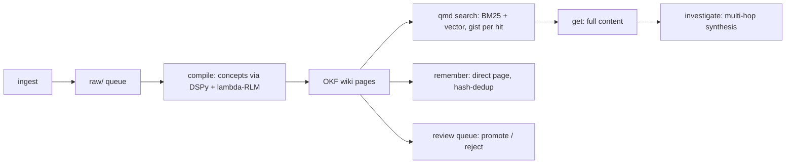
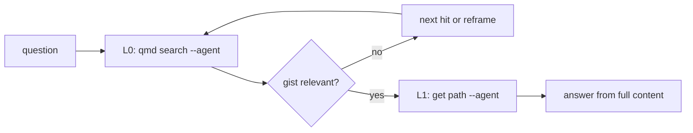

## Pipeline



- `ingest` files a URL or file into `raw/`. `queue` shows pending work; `inbox` processes inbox.md entries; `youtube` extracts dual subtitles.
- A URL that serves a document (PDF, DOCX, EPUB, …) is downloaded to `raw/papers/` with a metadata page; `compile` extracts it with anydoc, including hosted OCR for scanned pages. Images take the vision lane. Any other binary response is refused, never saved as a lossy markdown page.
- `compile` extracts concepts into OKF pages. `migrate-okf` is the one-time additive migration for older pages; `raw-normalize` cleans raw filenames.
- `qmd` (Rust) indexes markdown with BM25 + vector. Every hit carries a **gist**: about 350 characters from the OKF description or the first paragraph. Triage happens on gists; answers happen on full pages.
- `remember` saves durable knowledge directly as wiki pages with OKF frontmatter, deduplicated by content hash.

## Before a source is indexed

`raw/` is never in the QMD index — ingest and compile are separate steps, and search only sees the compiled tree. Discovery and access differ:

- **Find**: `chie ingest` prints an unstyled `saved_raw: <wiki-relative path>` line for every source it writes, and every ingest is logged with `Saved: <path>` in `log-<host>.md`. For connector lanes (X, Gmail, GitHub, YouTube, Reddit…) the path is in their `Saved … to <path>` output and the same log. `qmd search` and `chie query` do not find a source that has not been compiled.
- **Read**: `chie get` retrieves by ref/path — prefer indexed refs from search; it can also resolve existing local filesystem paths to indexed refs or read an existing local file, but it does not discover uncompiled sources. `chie source get raw/<…>` (MCP `chie_get_source`) is the read path for `raw/` sources with no index: markdown returns as UTF-8, pdf/epub extract via anydoc (hosted OCR on first extract), images return an actionable error, and anything outside `raw/` is refused.
- `chie queue` is the compile ledger; entries are created when compile starts, so a source ingested but never compiled does not appear there.

## The retrieval protocol (L0/L1)



Never answer from a gist alone. `chie sql --agent` is the metadata pass-through (counts, technical filters over FTS5/vector); `chie graph --json` maps relationships, communities, and gaps in the corpus.

A gist is a **write-time** distillation: `compile` wrote it without knowing your question. When the gate `derive` is enabled (it is, unless `typesafe.gates` names an explicit list that omits it), `chie query` appends a `raw:` block per hit — the span of the page's underlying source that actually answers *this* question, selected by Jev and copied verbatim:

```text
$ chie query "how is the JIT-Mem curator trained and what benchmarks does it beat"
30633563-3063356362 | τ²-bench | 0.69
  gist: Agent benchmark (tau-squared bench) used in JitMem evaluation...
  path: /…/entities/30633563-3063356362.md
…
== re-derived from raw (jev-1.13.0) ==
39346531-alfworld  [2609.27334.md s2 conf 1.00]
  raw: Given the retrieved traces and the new task, a memory curator synthesizes a
  compact, task-adaptive payload … improving over the strongest baseline by 16.2,
  16.3, and 3.9 absolute success-rate points, respectively.
```

Read the `raw:` block, not the gist, when the two disagree — the raw is the source of record and the gist is one distillation of it. It appears only where the source has something to say: a page with no `sources:` entry, or one where no span fits, contributes nothing, and the stderr line names which.

## Promotion

Memory conclusions and compiled candidates reach the live wiki through the review queue:

```bash
chie memory promote --conclusion <id>   # explicit, reviewable (ADR-0033)
chie review list                        # inspect pending entries
chie review show <page>                 # one candidate in full
chie promote <page>                     # accept (PAGE is required)
chie reject <page>                      # refuse
```

```text
$ chie review list
Page                                      Score  Links        Age
----------------------------------------------------------------------
30313733-near-linear-scaling               1.00     11         1d
30353936-dynamic-model-routing-with-a-decision-model   1.00      9         0h
30383965-state-based-routing-and-launch-as-query   0.85      1         4h
```

`Score` is the reviewer's own ranking and `Links` is how connected the candidate
is; a low-score, zero-link page is the one to read before promoting.

If it fails: `chie review` with no action, and `chie promote` with no page, are
both usage errors — every verb here takes its target. `chie memory promote` is a
different surface with a different argument (`--conclusion <id>`), so a
conclusion never moves by passing its id to `chie promote`. A compile-faithfulness
gate failure blocks `chie promote` by design (`--force` overrides, deliberately).

## Routing

| Need | Tool |
|---|---|
| Curated knowledge | `chie qmd search --agent` |
| What was decided | `chie memory recall` |
| Both planes at once | `chie qmd search --memory` |
| Academic papers (150M+, arXiv/OpenAlex) | `paperclip search` |
| Who the user is | Honcho (identity, feeds `chie memory import-honcho`) |
| Live, current events | web search, only after wiki and paperclip return zero |
| Summarize N documents | `chie map --agent` |

Learnings live in per-project `docs/learnings/`; search them before planning, and compound verified work back into them. flywheel's compound gate (`ce-compound`) is the usual writer; chiebukuro is the index.
