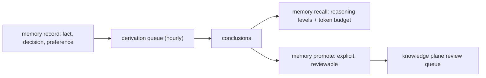

The memory plane answers "what happened, what did we decide". It is authority-distinct from the knowledge plane: conversational evidence, not curated truth.

## Lifecycle

- `record` appends and returns before derivation: writes never block.
- Derivation runs hourly; `repair` re-enqueues work an import or outage missed; `status` shows the queue.
- The conclusion vector index maintains itself: the hourly `memory-vectors` schedule embeds up to 200 pending conclusions after drain/extract/reason. `chie memory vectors build` is the unbounded catch-up path; `chie memory vectors status` shows the lag.
- The **Dreamer** consolidates nightly (bounded, `--dry-run` capable); `chie memory dreamer` runs a two-barrier SLEEP consolidation pass (ADR-0065 / ADR-0066: Stage-1 clean/audit + premise cascade, Stage-2 post-cascade synthesis).
- Explicit forgetting (`chie memory forget`) retracts wrong or unwanted conclusions (cascading derived descendants by default unless `--keep-derived`), rebuilds citing peer cards and representations, injects a `<retracted_do_not_reextract>` extraction guard, and never deletes raw events.
- Promotion is the only path from conclusion to wiki page (ADR-0033). Never auto-promote.

## Commands

| Command | Latency | Role |
|---|---|---|
| `memory record` | &lt;1s | Append an event |
| `memory ingest` | &lt;1s | Harness capture: one JSON envelope in, policy applied in Rust, event numbered per session |
| `memory prime` | &lt;1s | The blocks a harness injects: sealed system block + per-prompt recall, project-scoped |
| `memory recall` | 1s; ~10s with the `rerank` gate | Episodic recall over peers/sessions/conclusions; a query searches the whole store for events and conclusions (BM25-ranked with English stopwords dropped, any-term fallback when no row carries every term, then a literal substring fallback), and conclusions stay inside the peer/session/scope bound, no query browses the recent window. With the `rerank` gate enabled, retrieval widens to `min(8 × --limit, 200)` rows, the gate reorders them, and the display limit still decides what is shown. When the query is embedded and the conclusion index was built by the same model, the conclusion lane also reads the whole vec1 index: its ranking is fused with BM25 by reciprocal rank fusion and the slots are filled in fused order while a conclusion that restates an already selected one (cosine ≥ 0.90) is skipped, so `--limit` buys distinct facts rather than restatements (ADR-0063) |
| `memory chat` | 5-30s | Natural-language recall, memory-only loadout (includes zoom/date) |
| `memory view --session <id>` | &lt;1s | The session's saved summary-tree view (`<chat>` block; `--json` for nodes) |
| `memory zoom <id> <n> --session <id>` | &lt;1s | Open line `id+n` into its two halves; `n = 1` is the original message |
| `memory date <id> --session <id>` | &lt;1s | When message `id` happened (the view carries no dates) |
| `memory tree build` / `memory tree status --session <id>` | model-bound | Build queued tree nodes now (`memory.tree`, on by default); status shows built/queued/view bytes |
| `memory status` | 1s | Beacon: totals, derivation queue, per-workspace Honcho imports |
| `memory promote` | 1s | Conclusion to review queue |
| `memory dreamer` | 30-120s | Two-barrier consolidation pass; `--mode <consolidate\|rem\|both>`, `--synaptic-prune`, `--audit-transcripts`, `--dry-run` |
| `memory forget` | &lt;1s | Explicit conclusion retraction (`--id` or `--query`, preview by default; `--apply` commits, `--keep-derived` opts out of derived cascade) |
| `memory reason` | 5-60s | Model deduction, induction, retirement and identity card now (ADR-0058); `--dry-run`, `--log`, `--revert <rl-id>` |
| `memory explain <id>` | &lt;1s | Provenance of a conclusion or reasoning-log row: premises, supersession, log |
| `memory repair` | 5-30s | Backfill missed derivation |

## Coverage discipline

For full coverage query both planes: knowledge for curated facts, memory for what was decided and why. `chie qmd search --memory` spans both in one call and labels the source of each hit, which is how an answer cites "wiki says" separately from "we concluded".

## Facts from conversation

Structured derivation only promotes events that already carry intent (`chie_remember`, preference and decision signals). With `memory.llm_enabled` on (the default, ADR-0057) the `memory-extract` schedule (hourly at :35) also reads what the user said: batches of up to 40 captured events go to the memory model, which returns explicit atomic facts about the user, each citing the user messages that state it. A fact without a valid citation, an over-long one, and a restatement of a fact already known are dropped; a new value for a known fact supersedes it (the old one stays, marked superseded). Facts are explicit conclusions grounded on their messages, so peer cards, representations and recall pick them up and `chie memory zoom` opens the source. Each call takes the global LLM permit; a run makes at most 4 calls in each of 5 sessions. `chie memory extract` runs it now; `--dry-run` shows what is due.

With `memory.reason` on (the default, ADR-0058) the `memory-reason` schedule (hourly at :50) reasons over those facts with no review queue; trust is mechanical. One call proposes deductions (from 2+ facts), inductions (patterns over 3+ facts), retirements of facts a later one replaced, and contradictions; every citation must be an active conclusion shown in that call (same peer, same scope), or the item is dropped. Deterministic gates decide: a user's own statement is retired only by a newer statement from them, never by an inference; a contradiction goes to the user fact over an inference, else the newer user fact, else the more confident inference, and the loser is superseded by the winner. A second, independent verify call must confirm every surviving change, and a missing verdict counts as no. Inferences get calibrated confidence below user facts (a deduction at most 0.7 and 0.75 × its weakest premise) and fall automatically when a premise is superseded. A third call rebuilds the identity card (at most 12 cited identity markers). Every applied or discarded change lands in a log: `chie memory explain <id>` shows a conclusion's premises, what superseded it and each log row; `chie memory reason --revert <rl-id>` undoes one. A run is capped by `memory.reason_max_calls` (6) and `memory.reason_max_tokens` (40 000), each call takes the global LLM permit, a reply is applied only if the peer's facts did not change meanwhile, and an unchanged input makes no call. Reasoned conclusions are never promoted to knowledge.

## Two-tier dreaming, forgetting, and lifecycle barriers

The Dreamer is an elm-effect `Program` (`src/memory/dreamer_elm.rs`, ADR-0065 / ADR-0066) with journaled durability, typed proposals, strict two-barrier ordering, and fault-tolerant join semantics, synthesized with Google Research's SLEEP framework:

1. **Barrier 1 — Stage-1 Cleanup & Premise Cascade (`CleaningAndAuditing` -> `CascadingAndConsolidating`):**
   - Runs contradiction resolution (winner-preserving via `record_contradiction`), transcript reality auditing (`--audit-transcripts`, ADR-0064), duplicate consolidation, and TTL expiration (`durability = "invariant"` conclusions are immune to TTL expiry) against the pre-pass snapshot.
   - Applies Stage-1 transitions (or simulates the survivor set under `--dry-run` with zero SQLite writes) and invokes `reason::cascade_retired_premises` across all peers so any derived conclusion (`llm-deduction`, `llm-induction`, `dreamer-v2`, `dreamer-rem`, or any `derived_by` premise edge) loses active status before synthesis starts.
2. **Barrier 2 — Stage-2 NREM/REM Synthesis (`Synthesizing` -> `OrganizingAndCompacting` -> `Releasing`):**
   - **Tier 1 NREM Consolidation & Synaptic Pruning:** Gathers surviving conclusions into grounded higher-order inductions, rebuilds citing peer cards and representations (`RefreshPeerCard` / `RefreshRepresentation`), and records claim-buffer synaptic prune watermarks (`--synaptic-prune`) while keeping raw events intact.
   - **Tier 2 REM Dreaming (`--mode rem`):** Explores associative patterns across adjacent peer/project clusters in the resonance zone ($0.40 \le \text&#123;cosine} \le 0.85$; $> 0.85$ deduplicated as restatements, $&lt; 0.40$ dropped), pre-synthesizing multi-fact links for $O(1)$ online recall (PV4 benchmark: `scripts/recall-ranking-eval/pv4_multi_fact_eval.py`).
   - **Ledger & Dry-Run Discipline:** `dreamer_runs` records finished live passes (`compact_dreamer_ledger` retains 30); aborted or `--dry-run` runs never record completion and perform zero SQLite mutations.
3. **Explicit Forgetting (`chie memory forget`):**
   - Retracts targeted conclusions with `retracted_reason = "user_forget"` (preview by default; `--apply` mutates), cascades derived descendants by default (`--keep-derived` opts out), rebuilds any citing peer card or representation, and suppresses re-extraction of matching user-forgotten claims via `<retracted_do_not_reextract>` in `chie memory extract`.

Run `chie memory dreamer --all --dry-run` to preview proposals, `--mode rem` for cross-scope synthesis, `--synaptic-prune` for claim buffer pruning, and `chie memory forget --id <id> --apply` to retract a wrong conclusion.

## Session summary tree

With `memory.tree` on (the default, ADR-0056) each session keeps a summary tree after OptChat: every message is a leaf, each pair of built siblings gets a summary of at most 512 bytes (a reply still too long after five attempts is cut to 512 with `…`), and the session's view is a list of lines `id+n|text` that only grows at the end until it passes 128 KB, when a batch replaces the most-due pairs with their parent until it is back under 64 KB. Lines before the merged region are unchanged, so a host's prompt cache keeps hitting. `prime` puts the view in the session block; an agent zooms any line it needs in full (`memory zoom`, `chie_memory_zoom`), down to the original message. Building runs on the `memory-tree` schedule under the global LLM permit, or a scripted summariser via `memory.tree_summarizer`.

Host compactions carry the view: OpenCode and oh-my-pi give their own summariser a freshly primed block, and pi uses the view itself as the compaction summary when it covers every captured message (`CHIEBUKURO_PI_COMPACTION=default` keeps pi's summariser). Cost, measured on a 131-message session with `zai/glm-5.3-flash`: 164 nodes fit without a model call, 95 were model-written, in 267 calls (retries for too-long lines included), 1.22M prompt and 44k completion tokens, 990 s wall.

Harness capture rides alongside: the opencode, pi, oh-my-pi, grok, Hermes and Gemini companions forward prompts, replies and tool activity to `chie memory ingest` as they happen (and inject what `chie memory prime` returns), and `chie sessions` mines extension capture files (ADR-0028) when a capture producer writes them. Honcho imports feed identity ("who the user is") into the memory plane via `chie memory import-honcho`; identity stays distinct from knowledge.

Rate limiting is handled for you: an LLM call semaphore with desynchronization jitter, plus a separate session-work limiter sized alike, queue derivation and synthesis, so callers never hand-throttle.
