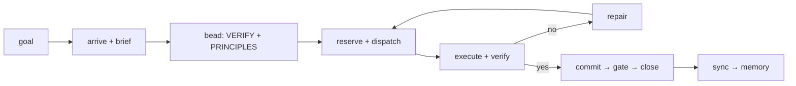
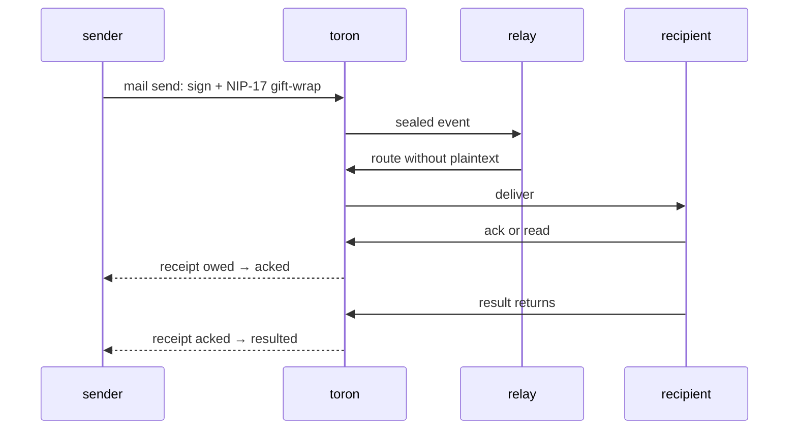
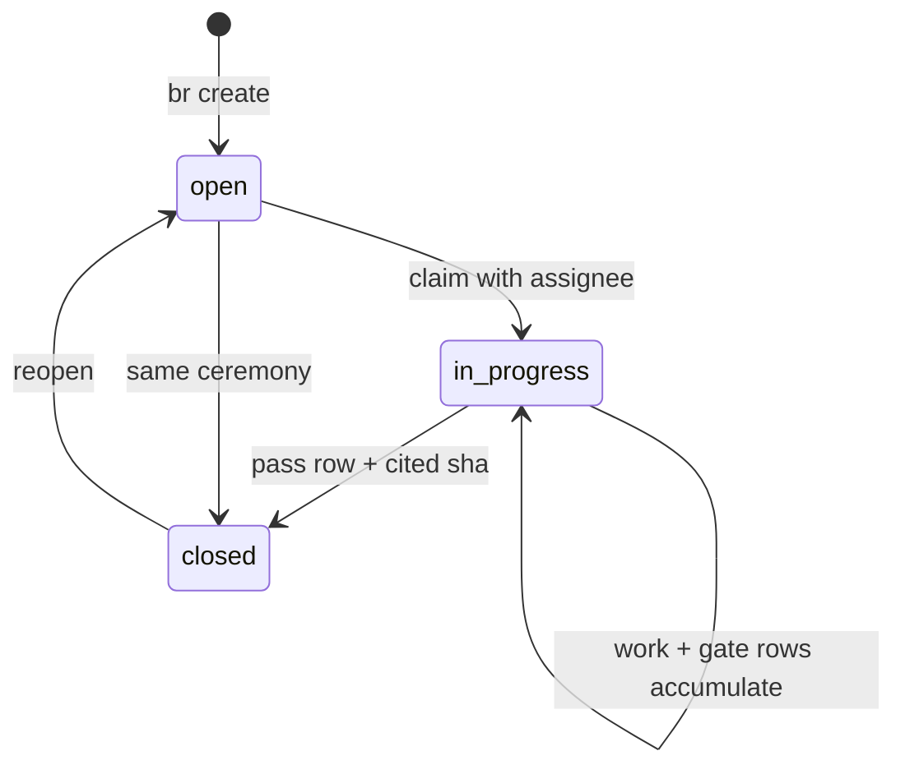
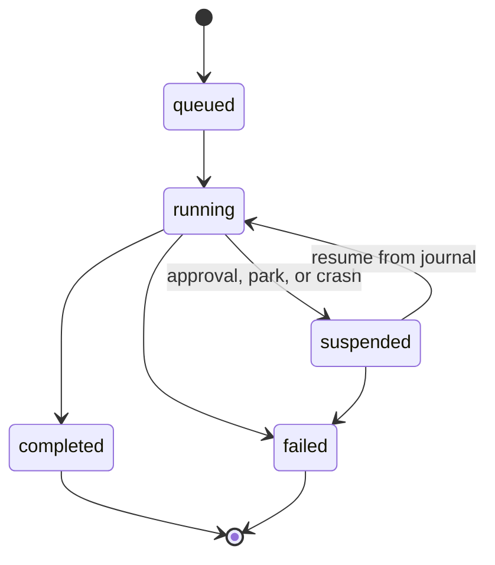
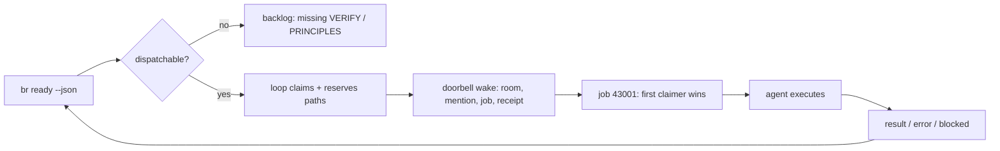
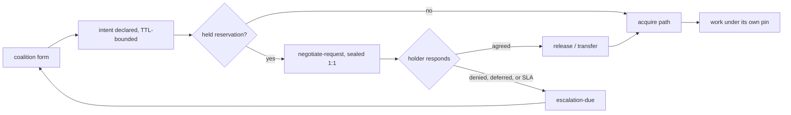
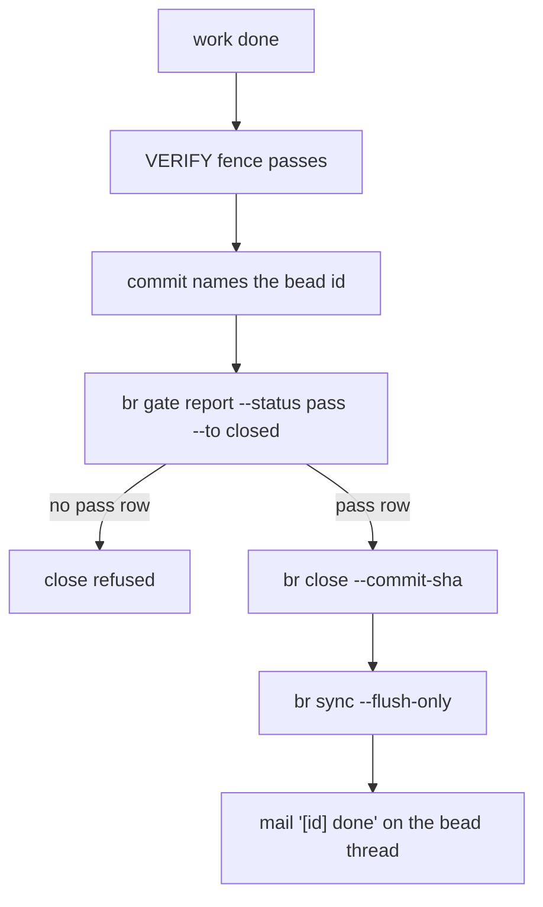
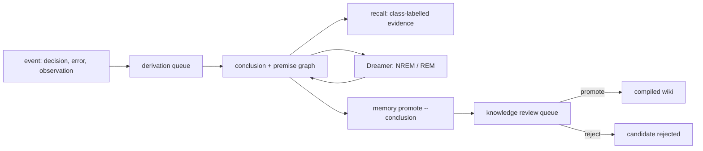

The stack is not a queue with four logos on top. It is a loop of durable artifacts. A goal becomes a claimable work
item, the item carries a verification fence, the handoff is signed, the close needs evidence, and the result becomes
memory the next run can query.

These eight diagrams follow one run from arrival to recall. Each one names the state that survives the pane, the
command that moves it, and the point where the stack refuses to pretend.

## 1. One run, four planes



The handoff between each pair is an artifact, not a function call: a bead with a verify command, a live path lease, a
claimed work item, a receipt, a gate row, a cited commit, and a conclusion. That is why a killed pane can lose its
process without losing the run.

## 2. Signed mail and the receipt state machine



The relay routes the envelope and never receives the body. A send creates a per-recipient receipt at `owed`. An ack or
read moves it to `acked`; an explicit result moves it to `resulted`. The store is monotonic and never downgrades. If the answer path is lost after a durable
enqueue, the state is `degraded`: visible, never silently green, and not an invitation to resend.

The mailbox receipt proves a message moved. It does not prove a workflow effect happened. Those are separate stores,
which is the point of the next two diagrams.

## 3. A bead becomes dispatchable before anyone claims it



`ready`, `blocked`, and `deferred` are views over `open`, not a second set of statuses. `br ready` only returns work
that is open, unblocked, not deferred, and dispatchable. Dispatchability means a `## VERIFY` section with exactly one
single-line command, plus a `## PRINCIPLES` citation when priority is 2 or higher. Work without that fence stays in the
backlog by design.

Claims go stale on a clock: about two hours for an agent, about a business day for a human or unclear claim. A live
reservation, a recent comment, or dirty files in the claimed paths means the claim is still active. Reclaiming starts
with an audit comment, not a silent takeover.

## 4. The run and the effect are different machines



A durable run can be `suspended` without being failed. A `park` waits on absolute time and hands its intent to the
journal before waiting, so a crash resumes the wait instead of losing it. A workflow lint failure is fail-stop: the run
never starts dirty.

The effect journal is not the run state machine. A real external effect moves through:

```text
Prepared → Claimed → Running → Delivered
                           → Failed
                           → Unknown
```

`Accepted` means a queue took the work, not that a provider delivered it. `Unknown` is a truthful outcome and stays
visible. Suspended, terminal, settled, and business completion are four different claims; the stack never collapses
them into a green checkmark.

## 5. The loop dispatches; the doorbell wakes



`flywheel loop-mode run <project> --work` is the durable dispatch state machine. One live loop runs per project, and
running the same command after a crash is the recovery path. Wave labels hold higher waves behind lower ones; a
`wave-N` item is not stuck, it is gated. More than three ready beads trips a one-poll flood guard on purpose.

The doorbell is the wake plane: room posts, mentions, jobs, and receipts become one prompt line. A dispatch to a busy
actor is latched into its durable inbox rather than aborted. The loop and the wake path are related, but neither needs
the other to be running.

## 6. Coalitions negotiate before they collide



A coalition is a captain-formed grouping of pane crews with a goal workflow and a NIP-29 intent board. Crews declare
intents before acquiring. Acquiring against an in-TTL intent is a **soft conflict**: freeze and propose. Acquiring
against a held lease is a **hard conflict**: blocked. The negotiation ladder records `pending`, `responded`, and
`escalation-due`; an elapsed SLA is a signal to escalate, not to work around the lease.

The atomic reservation remains the enforcement floor. Intents make contention negotiable before it becomes a block.

## 7. The close is a legal transition, not a status update



The commit comes before the gate row because the row's note must carry the full 40-hex `sha=<sha>` token that
`flywheel ledger check` binds to the revision. The close resolves the sha read-only and refuses a commit that does not
cite the bead. `--force` waives dependencies, never evidence.

The close is one report with two channels: `--reason` is the durable ledger record, and the mail on the bead thread is
the captain's copy. A close nobody is told about is invisible to the next coordinator.

## 8. Memory compounds without inventing truth



The memory plane answers "what happened, what did we decide". The knowledge plane answers "what is curated to be true".
A conclusion is evidence, not a wiki page. Promotion is explicit, reviewable, and never automatic; reasoned conclusions
are never promoted. Recall labels each hit by class so "we recorded this" stays distinct from "we concluded this".

The Dreamer is a journaled consolidation program: NREM distillation and pruning by default, REM cross-scope synthesis
on request. `memory explain` shows premises and supersession, and `memory zoom` opens a summary line back to the
original message. The next run gets context with provenance instead of scrollback with confidence.

## State is the interface

| Plane            | Artifact         | Legal state                                                       | Read it with                                            |
| ---------------- | ---------------- | ----------------------------------------------------------------- | ------------------------------------------------------- |
| toron            | Message receipt  | `owed → acked → resulted`, or `acked → degraded`                  | `toron receipt get --corr <id>`                         |
| beads            | Work item        | `open → in_progress → closed`; reopen is explicit                 | `br show <id> --json`, `br gate list <id>`              |
| toron + flywheel | Durable run      | `queued → running → suspended → completed or failed`              | `flywheel artifacts <run-id>`, `toron doctor`           |
| flywheel         | Project loop     | `active → idle or blocked → resumed`; one per project             | `flywheel loop-mode run <project> --robot-status`       |
| toron + flywheel | Path reservation | `intent → held → released`; hard conflict blocks                  | `toron reserve list --project <project>`                |
| chiebukuro       | Conclusion       | `event → derivation → conclusion → review → promoted or rejected` | `chie memory status --json`, `chie memory explain <id>` |

A state is not a label on a dashboard. It is a durable row with a command that moves it and a reader that can prove it
later. The [architecture page](/architecture#states) carries the same table next to the ownership boundaries, and the
[walkthroughs](/docs/guides) exercise each transition on a real host.

## Latest on the loop

| Capability         | What it changes in this run                                                                                         |
| ------------------ | ------------------------------------------------------------------------------------------------------------------- |
| **Effect kernel**  | Reducers stay pure; interpreters perform I/O; settled, unknown, and business completion remain distinct.            |
| **pstack pickup**  | A resumed bead runs its VERIFY fence first; a green fence means the work is already done and is not repeated.       |
| **Judgment packs** | Calibrated judgments return as evidence. They never dispatch, settle delivery, close a bead, or turn unknown green. |
| **Coalitions**     | Intents make file contention negotiable; the held reservation stays the hard floor.                                 |
| **Doorbell**       | Wakes are journaled observations, not pushes; a busy actor's dispatch waits in a durable inbox.                     |
| **Dreamer**        | Consolidation is a durable program, not a nightly guess; promotion stays a separate reviewed action.                |

## Next

- [Architecture](/architecture) names the owner of every artifact in these diagrams.
- [Run a swarm loop](/docs/guides/run-a-swarm-loop) creates and dispatches a bead with the real CLI.
- [Survive a crash](/docs/guides/crash-recovery) kills the daemon and reads what survived.
